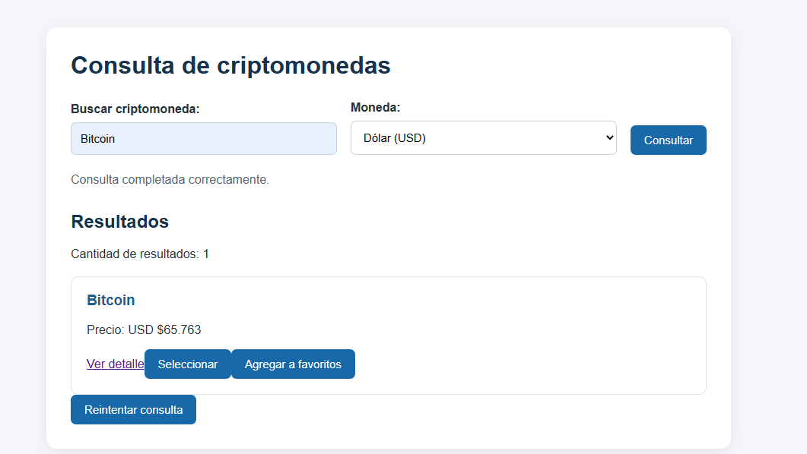

# Informe técnico – Actividad 3

## Proyecto Pulso Abierto

### 1. Prueba del sistema de favoritos

.png)

### 2. Pruebas automatizadas

Se ejecutaron pruebas automatizadas con Vitest para comprobar el funcionamiento del sistema de favoritos y del servicio de consulta de criptomonedas.

Resultado: 7 pruebas aprobadas.

.png)

### 3. Servicio de consulta de criptomonedas

Se organizó el servicio de consulta de precios utilizando fetch para obtener información desde la API de CoinGecko. Se incorporó una validación de la respuesta HTTP y se utilizó Zod para comprobar que los datos recibidos tengan el formato esperado.

También se validó que la moneda seleccionada sea USD o ARS, evitando procesar opciones no permitidas.

### 4. Manejo de estados de la aplicación

La aplicación utiliza estados para controlar la carga de información, los posibles errores y los resultados de las búsquedas. También permite volver a realizar una consulta cuando ocurre un error.

Se utiliza Zustand para compartir el estado de favoritos entre los distintos componentes y mantenerlo guardado en localStorage.

### 5. Uso de inteligencia artificial

Se utilizó una herramienta de inteligencia artificial como apoyo para comprender e implementar mejoras en el sistema de favoritos, organizar el servicio de consulta y preparar las pruebas automatizadas.

Las sugerencias fueron revisadas y comprobadas mediante la ejecución de la aplicación y las pruebas con Vitest.

### 6. Diagnóstico y verificación

Se verificó el funcionamiento de los favoritos desde la aplicación y se comprobó que los datos se guardaran en localStorage. También se realizaron pruebas automatizadas para comprobar que el sistema agregue y quite criptomonedas correctamente y que el servicio responda ante errores HTTP y datos incorrectos.

Los resultados permitieron confirmar el funcionamiento de las mejoras implementadas.

### 7. Verificación del funcionamiento de la aplicación

Se realizaron pruebas manuales para comprobar el funcionamiento de las consultas de criptomonedas en dólares (USD) y pesos argentinos (ARS). También se verificó la apertura del detalle de Bitcoin, la sincronización de favoritos entre pantallas y la persistencia de los cambios después de recargar la aplicación.

Los resultados fueron correctos y coincidieron con el comportamiento esperado.

